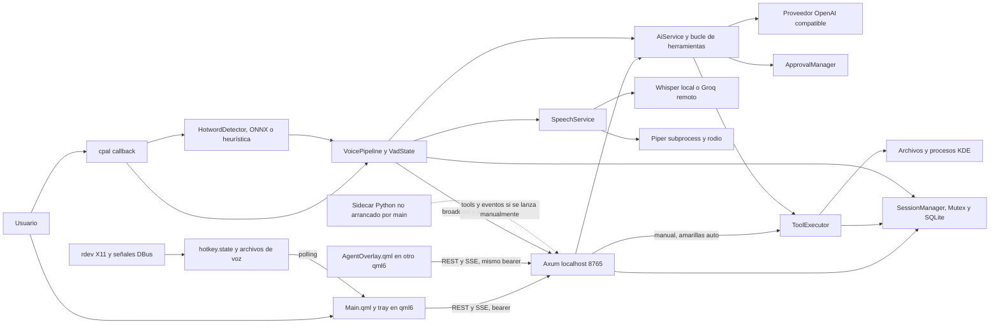
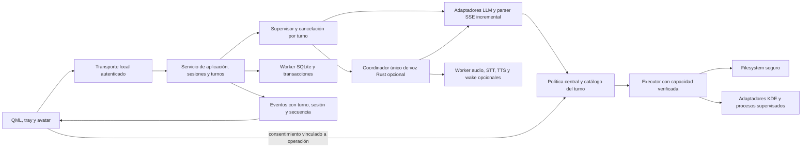

# Arquitectura observada y propuesta

Fecha 2026-10-10; baseline `main@12da960ed4722401f1cb42b7a96d9cef912cf90a` más cambios previos del usuario en hotkey_listener. Esta es una descripción del código; la disponibilidad real de cada flujo está en [RESULTS.md](RESULTS.md). La arquitectura propuesta es una decisión recomendada, no implementada.

## Arquitectura actual

No hay objeto Rust integrado en el motor Qt ni bindings cxx-qt activos. `src/lib.rs:3` los deja como futuro y Cargo no los declara. El proceso Rust crea un runtime Tokio, HTTP Axum, SQLite y servicios de voz; inicia uno o dos procesos `qml6` (`src/main.rs:69`, `:371`, `:390`). Qt ejecuta UI y XMLHttpRequest en su propio proceso. El hecho de separar procesos evita ejecutar SQLite en el thread Qt, pero no elimina I/O de QML ni bloqueos de Tokio/audio.

| Límite | Implementación y evidencia | Consecuencia |
| --- | --- | --- |
| Arranque | `src/backend/mod.rs:67`, `src/main.rs:75` | Descarga/prepara voz antes de publicar texto. |
| IPC UI | `src/backend/http_server.rs:124`, `qml/Main.qml:188` | REST/SSE con token de capacidad completa. |
| Config | `src/models/config.rs:562`, `http_server.rs:1178` | JSON, RwLock global mutable; defaults ante error/contención. |
| Sesiones | `src/backend/session_manager.rs:73`, `http_server.rs:43` | Una conexión SQLite síncrona compartida vía std::Mutex; WAL no implica acceso paralelo a esa conexión. |
| Chat/agente | `src/backend/ai_service.rs:248`, `:407` | Streaming SSE del proveedor, bucle ReAct con max configurable, tareas anidadas. |
| Autorización | `ai_service.rs:490`, `http_server.rs:1004`, `tool_executor.rs:78` | Distribuida entre caller, endpoint y flags; executor sin consentimiento efectivo. |
| Voz | `src/backend/voice_pipeline.rs:790`, `speech_service.rs:235` | Autoridad Rust actual, flags y máquina de estado parcialmente redundantes. |
| Escritorio | `src/backend/hotkey_listener.rs:295`, `main.rs:399` | rdev + archivos, DBus emitido; overlay Wayland layer-shell independiente. |
| Avatar | `qml/agent/CharacterController.qml:1`, `qml/agent/AgentOverlay.qml:238` | Fachada de expresiones/animación alimentada por SSE; fallback standalone decidido al inicio. |

## Flujos reales

### Inicio y cierre

`main` procesa flags, inicializa backend, espera ensure_models, crea AiService/SessionManager/SpeechService/HotwordDetector/KdeIntegration y VoicePipeline (`src/backend/mod.rs:70`). Prewarm Whisper y Piper se agenda después (`src/main.rs:80`, `:96`). La comprobación del puerto llega después del trabajo de arranque (`:122`) y libera el listener antes del bind real: hay una carrera de instancia única. Error del servidor queda en una tarea/log (`:136`), no necesariamente detiene la UI.

Con wake habilitado se inicia captura (`main.rs:153`); después atajos/KDE y UI. El módulo generado qml.auth contiene token, cacheDir y flag de overlay (`:345`). Main.qml se ejecuta con QApplication y ruta relativa; overlay sólo si personaje habilitado y plataforma Wayland (`:343`). No hay búsqueda efectiva de assets instalados a través del resolver app_paths.

Cerrar ventana oculta al tray (`qml/Main.qml:32`); la acción de salir sí termina Qt (`:1320`). Main supervisa al hijo principal y mata su overlay al finalizar (`src/main.rs:423`, `:447`), pero no hay protocolo de drenaje de HTTP, transacciones, audio y todos los hijos. El limpiador de procesos por nombre previo al arranque no equivale a supervisión de instancias propias (`:478`). Cierre íntegro real pendiente.

### Chat y proveedores

QML crea/selecciona sesión y envía POST /api/chat; procesa eventos SSE y acumulación de responseText (`qml/Main.qml:159`). Router autentica (`http_server.rs:70`), build_messages carga SQLite, memoria y prompt (`:1791`), toma tools/policy de config y lanza run_agent (`:1720`). Usuario se persiste inmediatamente, resultado al terminar con éxito (`:1737`, `:1755`).

AiService crea petición OpenAI compatible, añade headers específicos del proveedor (`ai_service.rs:275`), consume bytes_stream y convierte a eventos Token/ToolCall/Done (`:311`). Cada iteración crea una tarea hija call_once (`:429`); ante tools agrega assistant tool_calls, obtiene confirmación según política, ejecuta y reinserta resultado (`:464`, `:490`, `:579`). Default max es 8, pero el valor configurado no se acota como límite absoluto (`:407`).

OpenRouter/Groq/OpenAI/custom tienen selección de clave/config (`src/models/config.rs:164`). Presets de servidores locales existen (`:121`), pero el cliente exige key no vacía incluso para custom (`ai_service.rs:252`). Integración real con proveedores/model listing/error/rate limits no probada. El fixture custom confirmó ruta, streaming, historial y el defecto UTF-8; no certifica compatibilidad externa.

Cancelación aborta el padre registrado por sesión (`http_server.rs:183`), no la tarea hija HTTP automáticamente. Repetición/desconexión y herramientas necesitan identidad de turno, scope y estado terminal; hoy registro usa clave de sesión/default (`:1466`).

### Herramientas y permisos

Catálogo real: 23 schemas (`src/backend/tool_registry.rs:43`), separado de executor de 3.088 líneas. Flags filtran catálogo; método por herramienta consulta config otra vez. Paths se canonicalizan a string antes de fs async (`tool_executor.rs:181`), sin descriptor que fije el objeto autorizado. El contexto de ejecución sólo transporta session_id/decided y alimenta auditoría.

Ruta agente: ApprovalPolicy -> ApprovalManager -> ToolExecutor. Ruta manual: validación de nombre -> rechazo rojo -> ToolExecutor con auto. Las aprobaciones se indexan sólo por tool_call_id, no por turno/sesión/argumentos (`src/backend/approvals.rs:44`, `:82`); una colisión entre llamadas concurrentes puede resolver una distinta. Además se emite el evento antes de registrar petición (`ai_service.rs:525`, `:532`), carrera no reproducida. Es necesario que el executor reciba y compruebe una autorización emitida por política central; no confiar en la etiqueta decidida del caller.

Tools usa procesos con argumentos separados y SQL parametrizado para auditoría. Ni ejecución del comando ni archivos se aíslan con sandbox. Auditoría es best-effort, guarda argumentos y comparte mutex SQLite (`tool_executor.rs:133`); no es un ledger transaccional de efectos.

### Voz, dictado y wake word

Captura cpal convierte/resamplea y fan-out hacia canal wake y VoicePipeline (`src/backend/audio_capture.rs:188`, `src/backend/mod.rs:219`). Callback no es libre de I/O: push_audio emite nivel escribiendo archivo síncrono (`voice_pipeline.rs:425`). Hotword ML hace inferencia ONNX dentro de task Tokio; si carga falla usa energía/ZCR, no reconocimiento de frase (`hotword.rs:201`, `:270`). VadState nativo es energético/adaptativo (`vad.rs:1`), no WebRTC/Silero.

PTT/wake/dictado comparten flags/buffer; dictado tiene flag de exclusión con voz (`http_server.rs:43`, `voice_pipeline.rs:251`). Voz procesa utterance -> STT -> contexto/LLM -> SentenceChunker -> síntesis por oración -> reproducción; crea operación, pero no la usa para invalidar resultados viejos (`voice_pipeline.rs:795`). SpeechService puede elegir Groq cuando auto y proveedor activo Groq con key (`speech_service.rs:277`), Whisper se ejecuta spawn_blocking (`:264`) y TTS con rodio en worker bloqueante (`:201`). Piper es proceso fresco por síntesis (`tts/piper.rs:201`).

Eventos de estado/nivel/intercambio se publican por broadcast y archivos de compatibilidad. HTTP, Main.qml y overlay observan caminos distintos. Voz reconstruye contexto con sesión seleccionada y luego vuelve a elegir sesión al guardar (`voice_pipeline.rs:997`, `:839`); sólo persiste texto final, pierde tool history. El avatar reacciona a estados y actividades; su harness valida partes del mapping, no este ciclo real.

### Sidecar Python

`voice_agent/main.py` tiene pipeline completo alternativo: LocalAudioTransport -> WakeGate openWakeWord -> Groq STT -> Groq LLM + tools vía Rust -> Piper. Control aiohttp localhost:8766 sin auth; puente a Rust:8765 con bearer (`main.py:388`, `:480`). Mantiene configuración/historial propios, no sesión SQLite autoritativa; HistoryTap envía respuesta vacía (`:319`). `spike_bot.py` es otro experimento.

En main Rust, sidecar_child permanece None y sidecar_active false. Hay endpoints/ramas de compatibilidad, pero no un ciclo de vida conectado. No es válido llamarlo autoridad de voz actual ni sumar automáticamente su coste al reposo. Su impacto sólo existe al iniciarlo manualmente. AST parse pasa; ejecución bloqueada por dependencias ausentes.

## Arquitectura propuesta: reconstrucción parcial

Decisiones recomendadas:

1. **Una autoridad de aplicación Rust.** Identidad inmutable de turno/sesión, config versionada por operación, tareas/hijos bajo un supervisor. Eventos ordenados con estado terminal y op-id. Nada de estado de negocio determinado por timers QML.
2. **Una autoridad de voz Rust, opcional.** PTT local primero; wake ML después. Captura no depende de wake, callback sólo comunica frames acotados. Servicios declaran disponibilidad; falta Piper no impide texto. Whisper lazy, STT remoto con elección explícita. Elegir estrategia Piper persistente o proceso por utterance tras medir, manteniendo supervisión y cancelación en ambos casos.
3. **Python fuera de la ruta de producción.** No adoptar Pipecat como segundo LLM/permiso/sesión. Conservar temporalmente evidencia experimental y después archivar/deprecar según decisión del mantenedor. Si una biblioteca exige worker Python en el futuro, éste será de inferencia, contrato acotado, sin permisos ni autoridad de conversación.
4. **Política única en el límite ejecutor.** Aprobación vinculada a turno, usuario/origen, argumentos, rutas y efecto; directorios fijados por descriptor. Revocación explícita y defaults restrictivos. Manual UI no comparte una capacidad indistinguible del agente autónomo.
5. **Persistencia como worker y journal.** Conservar DB y esquema migrable; registrar intención/resultado/cancelación sin perder herramientas parciales; transacciones y errores visibles. Filtrar/redactar logs y auditoría.
6. **Conservar HTTP/SSE en v0.1 bajo contrato comprobado.** Cambiar a cxx-qt ahora multiplica el alcance. Evaluar socket Unix o bootstrap privado para endurecer IPC y scopes; no asumir que origin sustituye auth. Tokens/redacción se reparan antes de distribuir. QML usa servicios cliente comunes en lugar de duplicar cada parser/controlador.
7. **Escritorio como adaptador verificable.** KGlobalAccel/portal o integración equivalente para Wayland; rdev sólo como capacidad X11 declarada. Tray DBusMenu y layer-shell con pruebas reales, handshake y fallback. Paths instalados independientes de CWD.

## Comparación de estrategias

Estimaciones cualitativas; no hay fechas o esfuerzo en semanas validado.

| Alternativa | Coste inicial | Riesgo y complejidad | Reutilización | Capacidad de entrega |
| --- | --- | --- | --- | --- |
| A. Refactorización incremental | Bajo–medio | Parches locales rápidos; límites de autorización/cancelación cruzan muchos callers y pueden permanecer inconsistentes. | Máxima, también retiene estructuras problemáticas. | Buena si alcance texto se restringe; difícil declarar herramientas seguras sin rediseñar límite. |
| B. Reconstrucción parcial | Medio | Migración de contratos y ownership exige pruebas; evita dos autoridades y limita sustitución a puntos fallidos. | Alta: DB, QML/avatar, tokens visuales, schemas, helpers y tests puros. | Mejor: gates de texto, tools, KDE y voz independientes. |
| C. Reescritura completa | Alto | Rehacer KDE/QML/voz y migración; regresiones nuevas sin evidencia de que componentes existentes sean irrecuperables. | Baja salvo datos/assets/especificación. | Retrasa producto y pierde partes ya verificadas. |

**Recomendación B**: SEC-01/02 requieren reconstruir el límite efectivo; REL-04/VOI-01 requieren ownership de turno; REL-02 exige servicios opcionales. El happy path HTTP/SQLite y harness QML demuestran reutilización viable. La forma de entrega será incremental, sin mantener indefinidamente una ruta insegura alternativa. No se inició esta arquitectura.
