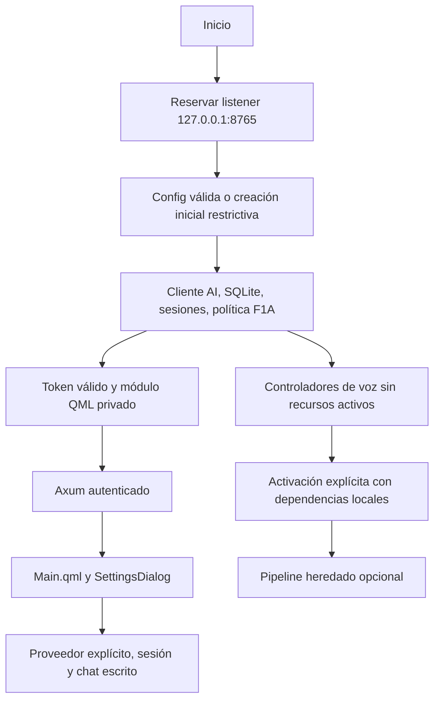

# F1B-1 — Arquitectura de arranque por capacidades

Fecha: 2026-10-10. Base `ca82e722935e8076f526a484655f2f95f87b5d4c`. Se conserva Rust/Tokio + Axum REST/SSE + qml6 + SQLite. No se introduce otro transporte ni una segunda autoridad de conversación.

## Antes

Backend::new cargaba configuración, descargaba modelos y ONNX Runtime y creaba AI/sesiones/tools/voz. SpeechService::new exigía PiperEngine::new; HotwordDetector::new intentaba cargar ML. Main precargaba Whisper y sintetizaba con Piper, comprobaba/liberaba el puerto después de todo ese trabajo, publicaba HTTP en una tarea y toleraba fallos del token/QML bootstrap. Antes de lanzar UI mataba procesos por `qml6.*Main.qml`.

Una ausencia de Piper bloqueaba texto. Los downloads se ejecutaban aun con wake apagado. F1A ya fallaba cerrado frente a config corrupta, pero también rechazaba instalación nueva sin config.

## Ahora

El listener reservado permanece bajo ownership del main; no se hace probe seguido de rebind. Una instancia adicional falla antes de tocar configuración/token/DB de la existente. Si configuración, SQLite, token o bootstrap QML falla, no se publica una API privilegiada y el proceso libera su listener. Si qml6 no puede lanzarse o termina con error, el error llega a stderr y el runtime/hijos propios se cierran. La tarea HTTP se supervisa por terminación; no se desarrolla el supervisor avanzado de F3.

| Capacidad | Inicialización |
| --- | --- |
| Config | NotFound crea first_run explícito. JSON/tipos/proveedor/URL/modelo inválidos o lectura fallida dan error recuperable, sin fallback. |
| AI | Construye reqwest Client; no contacta proveedor al arrancar. La clave se exige al pedir chat/modelos. |
| Sesiones/SQLite | Obligatorio, esquema existente sin migración general. |
| Tools/approvals | Conserva implementación F1A. Nueva instalación con todas las tools apagadas y allowlist vacía. |
| IPC | Token de 64 caracteres hex, archivos privados, Host/Origin exactos. |
| UI | Módulo qml.auth privado; mantiene REST/SSE e interfaz existente. |
| Piper | OnceCell vacío; construye el motor real en spawn_blocking bajo petición explícita. Sin sustituto ni fallback falso. |
| Whisper | Wrapper/path y mutex vacío; carga sólo para transcribir. Sin prewarm. |
| openWakeWord/ONNX | HotwordDetector no carga runtime/modelos en constructor. Sin llamada a downloader. |
| Micrófono/captura | AudioCapture None. El arranque ordinario no la activa, incluso si una config antigua guarda wake=true. |
| Chimes | Sin generación ni reproducción en constructor; recursos explícitos al activar voz. |
| Personaje/overlay | Config nueva apagada; conserva opción existente y proceso propio. Supervisión avanzada pendiente. |

Los controladores de voz se conservan como objetos de estado sin cargar modelos/audio. Se evita sustituir su arquitectura o copiar un pipeline nuevo. `--enable-voice` más wake habilitado permite intentar la ruta heredada exclusivamente con dependencias locales. Sin Piper/modelos/ML, devuelve disponibilidad/error y conserva texto. La ruta de activación exige ML real antes de abrir captura; no admite el fallback energético como wake de producción. No se certifica esta ruta con hardware en F1B1. El audio/PTT/API de voz queda diferido por defecto: solicitudes activas reciben 503 con motivo; streams de estado y selección de sesión siguen compatibles. Auto_speak del endpoint de texto y PTT respetan esa capacidad.

## Configuración y compatibilidad

- `Config::first_run()` es la única política de creación por ausencia; no importa una clave de entorno al archivo. Desactiva tool calling y los 23 flags de tools, wake/auto_listen/auto_speak/chimes, memoria/auto_summary y personaje. Allowed_paths queda vacío; STT se configura local.
- Defaults explícitos de estructuras/fixtures existentes se conservan; nunca se usan como recuperación de lectura fallida. Se mantienen las mitigaciones de campos omitidos de F1A.
- Carga de config existente conserva bytes y selección de modelo; se retira la migración automática de modelos supuestamente retirados. El usuario elige otro modelo desde Settings si el proveedor rechaza el anterior. La función de recomendaciones heredada y sus tests permanecen, sin llamada automática.
- Se endurecen explícitamente permisos de config/backup a 0600 y directorio de aplicación a 0700 al cargar. Token y archivos del módulo QML se crean privados desde el primer byte. Errores de permisos se propagan. Symlinks/hardlinks/propietario incorrecto en archivos bootstrap se rechazan; FIFOs no bloquean la lectura.
- Guardar valida, publica backup y principal mediante temporales exclusivos 0600 + sync + rename; luego update_config publica RAM. Backup y principal no forman una transacción conjunta; fsync del directorio tras rename puede fallar después de publicar. No se afirma rollback ante pérdida de energía o todas las clases de fallo del filesystem.
- GET config redacta api_key/provider_keys y añade has_api_key, nombres de proveedores con clave guardada y capabilities. Campos vacíos conservan claves; entradas no vacías reemplazan explícitamente. Al guardar, una clave legacy sin entrada activa no vacía se integra en el mapa por proveedor, conservando las demás. El valor literal legacy se conserva incluso si el mapa activo contiene otra clave o se cambia el proveedor; sólo una clave enviada explícitamente no vacía autoriza reemplazarla. No hay borrado implícito de claves mediante un formulario redactado; un flujo explícito de eliminación queda pendiente.
- La UI no pide catálogo de modelos ni enumera micrófono al cargar Settings o cambiar proveedor. La consulta de modelos queda en su acción explícita existente. Guardado fallido mantiene el diálogo y muestra el error. No se añaden proveedores ni se rediseña la UI.

## Contrato HTTP mínimo

El token inválido/vacío bloquea el bootstrap. Middleware rechaza también un AppState artificial con token malformado, incluso si el caller envía el mismo valor. Health permanece público y no devuelve credenciales.

Host debe ser exactamente `127.0.0.1:8765`, `localhost:8765` o `[::1]:8765` (comparación de caso normalizado). Ausencia, duplicados, puertos distintos y sufijos se rechazan. Origin omitido o `null` permite QML; los únicos Origins web admitidos son esas autoridades completas con esquema `http`. Paths, userinfo, prefijos, substrings, esquemas file/qrc y listas/duplicados no entran en la allowlist. El bearer se exige independientemente del origen. No hay garantía de aislamiento frente a otro proceso del mismo UID que puede leer las capacidades locales.

`serve` valida el token antes de bind; main reserva el socket una vez y obtiene AppState fallible antes de pasarlo a Axum. Se mantiene el puerto y compatibilidad QML nativa. Clientes que dependían de Host omitido, otro puerto o secretos en GET config deben adaptarse al nuevo contrato.

## Procesos y límites

OwnedChild sólo hace kill + wait de un Child que recibió tras spawn de esta instancia. Main/overlay y snap_ui lo usan también en salidas por error. snap_ui pide un display libre mediante Xvfb -displayfd; deja de borrar X99-lock y de terminar qml6/Xvfb globalmente. No se ejecutó snap_ui; su cambio se revisó y compiló.

Los fixtures de ejecutable solicitan SIGINT al PID propio antes de recurrir a la limpieza del guard. Se observa desaparición del PID QML propio y supervivencia de otro qml6 del fixture. SIGKILL/crash del padre y supervisión avanzada de descendientes no están resueltos en esta fase. El pkill del executor para close_app permanece fuera de esta corrección del arranque; no se ejecutó y la herramienta está desactivada en instalación nueva.

AiService/parser SSE, cancelación de tareas profundas y SessionManager se conservan. Unicode fragmentado sigue vulnerable; cancelación puede dejar request hijo activo; persistencia de turnos/herramientas no es transaccional. Son límites abiertos de F1B-2/recuperación, no funcionalidades resueltas por este cambio.

## Endurecimiento confirmado en revisión

La creación exclusiva de config/token sólo tolera AlreadyExists para releer el archivo de una publicación concurrente. Un fallo de escritura/sync se propaga aunque el destino ya esté publicado: no se continúa con bootstrap parcial como si hubiera tenido éxito. La prueba de EIO valida la clasificación del resultado; no certifica durabilidad ante un fallo real de fsync.

La consulta manual de catálogo toma URL y clave del proveedor seleccionado. Al cambiar proveedor descarta los campos legacy del proveedor anterior para resolver los mapas/presets del nuevo; las entradas no se eliminan de configuración. Dos mocks locales verifican que la credencial seleccionada no se envía al destino anterior.

Un error de espera del hijo UI retorna error, además de los fallos de spawn y exit no cero. Las pruebas identifican su argv qml6/Main.qml y cubren tanto ejecutable ausente como QML real que no carga. La reserva del listener nunca se cierra para volver a bind antes de transferirse a Axum. HTTP puede responder antes del primer frame QML una vez completo el bootstrap crítico; un fallo posterior de UI destruye el runtime y libera el listener.
