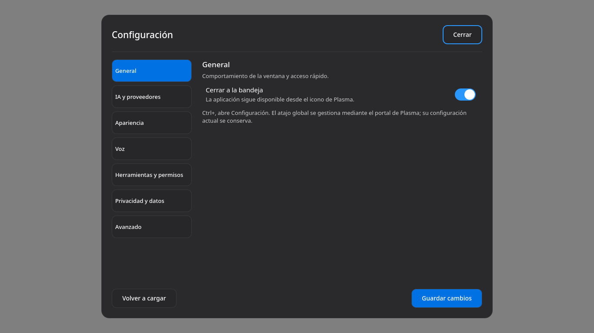
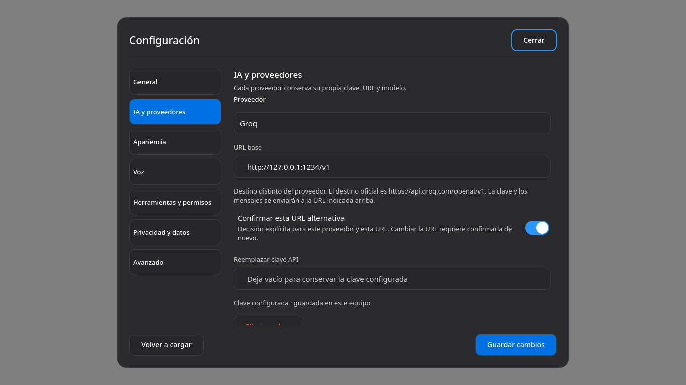
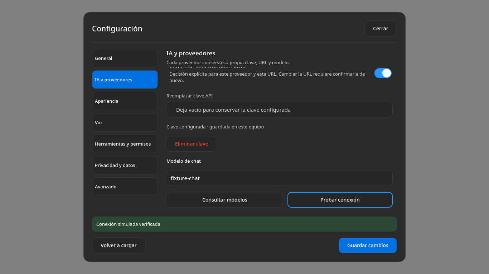
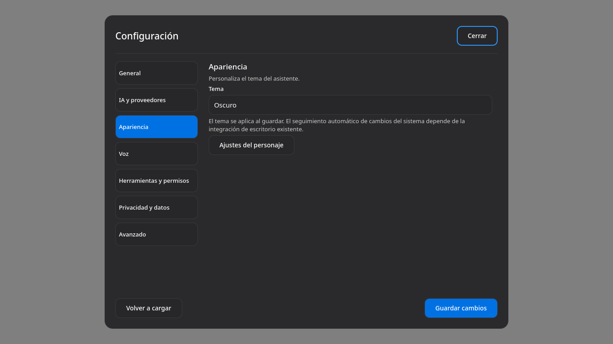
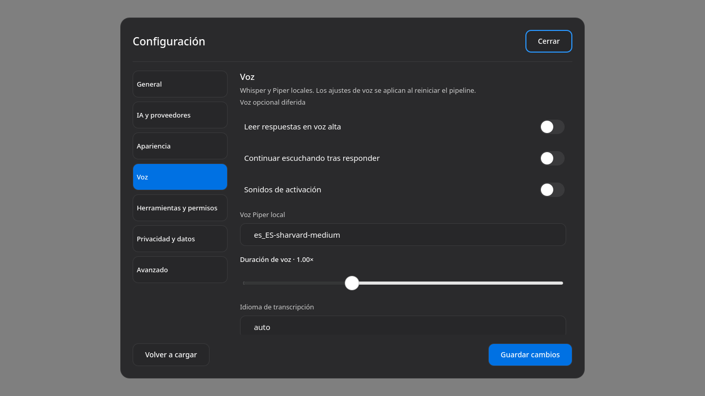
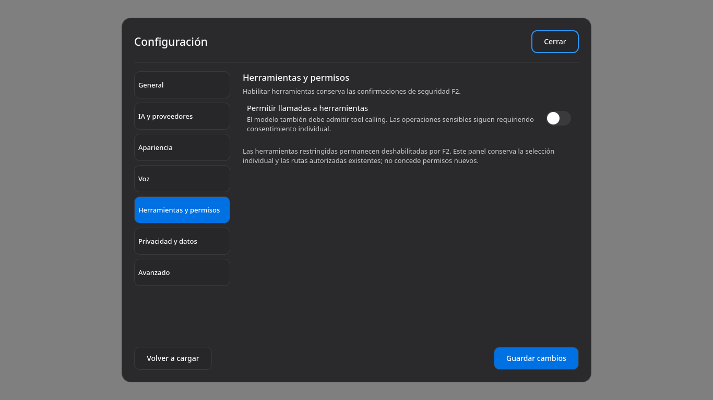
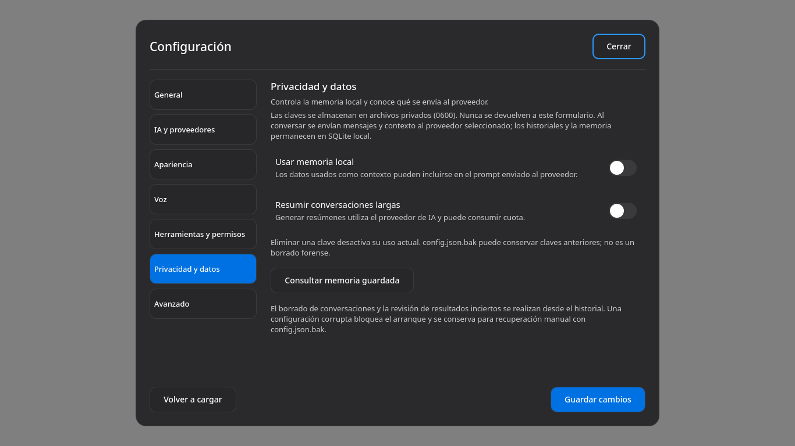
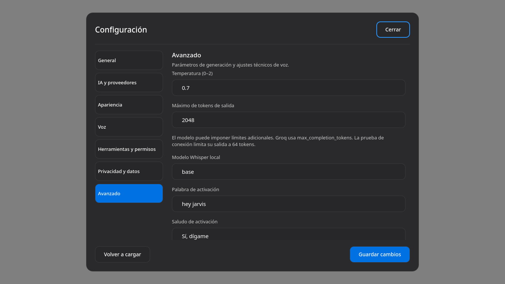
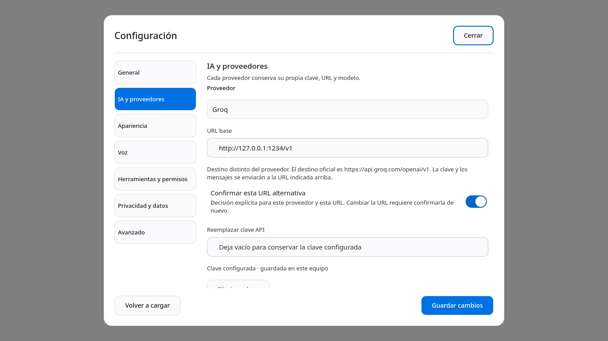

# F3.5 — Auditoría técnica

Revisión del diff completo respecto a `1d2186e5dae78ae9ddc1dbed01c44c9b7d67f920`, rama `recovery/f3.5-settings-providers`. Fecha: 2026-10-17. Se revisaron AGENTS, los contratos F1B/F2/F3, los cinco informes y los consumidores de credenciales. La revisión detectó fallos reales en la implementación inicial; no se dio por válido el estado READY_FOR_REVIEW sin comprobarlo.

## Hallazgos reproducidos y correcciones

Cada fallo funcional siguiente se añadió primero como regresión y falló antes de la corrección. La primera prueba de A35-09 fue inválida: la barrera de voz devolvía 503. El fixture corregido abre sólo ese flag sin iniciar audio y reproduce después la divergencia de memoria ante 500. Se conserva también el fallo del fixture. Los logs `before-*.log` de [evidencia de auditoría](F3.5-EVIDENCE/audit/) conservan ese resultado. Los nombres de claves en fixtures son sintéticos, sin validez externa.

1. **A35-01 / alta: pérdida de actualizaciones.** Dos lecturas del mismo documento, cambio reciente de permisos/configuración y posterior POST obsoleto devolvían 200. Se exige revisión opaca de todo el estado, incluidos secretos redactados, bajo el lock; revisión obsoleta 409 y ausente 428. La regresión preserva tanto una rotación de clave como el cambio reciente. No se cambia la autoridad de F2.
2. **A35-02 / alta: destino alternativo sin decisión explícita.** El mock recibió la clave sintética de Groq en loopback sin aprobación. Ahora se bloquea antes de red si el origen difiere del preset. La aprobación está vinculada al proveedor y URL exacta; cambiar URL vuelve a bloquear. Se conservan Custom y los fixtures que aprueban loopback. No se considera que la captura simulada demuestre un fallo de la cuenta Groq del usuario.
3. **A35-03 / media: falso éxito SSE.** El diagnóstico aceptaba `index` de tipo string o `tool_calls` malformado. Usa ahora el parser tipado de conversaciones. La aceptación de `finish_reason:length` es exclusiva del diagnóstico breve; no se relaja el parser normal.
4. **A35-04 / media: confirmación visual obsoleta.** Tras guardar, una pulsación real en el input mantenía «Guardado». Los campos/toggles/selectores marcan cambios pendientes. Un test adicional fuerza timeout, inicia otra petición y verifica que la respuesta tardía no modifica el estado ni emite otro `saved`.
5. **A35-05 / accesibilidad visible.** Los colores anteriores daban 3,34:1 en descripciones y 3,02:1 en el botón principal dark, insuficiente para su texto pequeño. Se usan tokens existentes: texto secundario `inkMuted80` (8,92:1 sobre surface dark) y primario `primaryFocus` (4,70:1 con blanco). Se aumentó la descripción a 13 px. No se rehízo el diseño.
6. **A35-06 / alta: consumidor STT compartía la clave sin las mismas protecciones.** Un mock 429 reflejaba texto remoto en el error y podía recibir dos intentos. STT ahora usa el cliente sin redirects/retries y respuestas acotadas/controladas; SpeechService valida el destino antes del cliente cacheado. No se ejecutó audio, micrófono ni motor F4.
7. **A35-07 / media: fallback plano entre perfiles.** Tras migrar OpenRouter y elegir Groq sin entrada propia, la URL/modelo efectivos seguían siendo los planos anteriores. Se elimina ese fallback cuando existen mapas; una selección sin modelo requiere definirlo, en lugar de tomar el de otro proveedor.
8. **A35-08 / alta: resurrección en migración mixta.** Un duplicado legado de OpenRouter podía reemplazar el tombstone vacío de Groq. Sólo el formato antiguo sin mapa se asigna al proveedor activo. Duplicados exactos se eliminan sin reasignar; valores distintos permanecen privados e inactivos hasta su eliminación explícita. Se verifican preservación, GET redactado, cambio de proveedor, reemplazo y eliminación del valor antiguo.
9. **A35-09 / media: preferencia de micrófono publicada antes de escribir.** `/api/audio/device` devolvía 500 ante backup symlink pero la memoria ya cambiaba. Se guarda un candidato y sólo se publica después del éxito; la regresión verifica memoria y bytes anteriores, sin consultar hardware.

10. **A35-10 / baja: warning QML al cerrar o fallar la lectura.** El bloque de clave antigua devolvía undefined para `visible` con `rawConfig` vacío. Se fuerza una expresión booleana; el runner ahora rechaza `Unable to assign`. La regresión reprodujo el warning antes de corregirlo.

## Flujo de configuración revisado

- Lectura privada nofollow y validación de configuración existente; sólo ausencia permite bootstrap. Corrupción no se convierte en defaults ni recuperación automática que reactive capacidades.
- Migración en memoria conservadora; GET redacta ambas representaciones y no materializa claves de entorno en JSON. Un test HTTP con entorno sintético comprueba estado `environment`, redacción, eliminación explícita, recarga desde archivo y bloqueo del fallback, conservando otro proveedor.
- POST exige revisión vigente; clona candidato, conserva claves con input vacío y aplica sólo eliminaciones explícitas. Las credenciales no vacías sólo reemplazan su propio ID. Se valida antes de escribir.
- El escritor F1/F3 conserva directorios 0700, temporales exclusivos y archivos 0600, backup atómico y fsync. El test con symlink comprueba conservación antes de publicación. No se añade almacén de secretos.
- Memoria actualizada sólo tras `save()` correcto para Configuración y preferencia de micrófono. La UI exige 200 y `status:ok`; ningún error cierra el panel o emite `saved`. Al reiniciar cambia el nonce de revisiones, requiriendo lectura nueva.
- El lock impide dos guardados simultáneos dentro del proceso; la revisión detecta documentos antiguos y cambios internos. No es un protocolo de edición externa del archivo ni de múltiples procesos escritores no coordinados.

## HTTP y SSE

Autenticación local F3 permanece en el router completo. Los overrides no cambian Host/Origin/bearer locales. URLs HTTP(S), sin userinfo/query/fragmento, con aprobación explícita para orígenes alternativos conocidos. No hay redirects ni replay automático, incluidos los retries de protocolo de reqwest. Las credenciales se aplican después de validar destino.

El diagnóstico envía sólo `Responde OK.`, sin herramientas ni historial; consulta catálogo y requiere que el ID exista. Groq usa `max_completion_tokens`, documentado en su [referencia oficial](https://console.groq.com/docs/api-reference); los parámetros y la URL se contrastaron con [compatibilidad oficial](https://console.groq.com/docs/openai). No se prueban claves personales. Errores 401/403/404/429/5xx/cuota/timeout/red/protocolo se clasifican sin texto remoto. DNS/TCP/TLS comparten categoría `network`; no se afirma diagnóstico específico de cada capa ni prueba TLS real.

Límites: catálogo/STT/diagnóstico HTTP 2 MiB; diagnóstico SSE 2 MiB; parser compartido 256 KiB por evento, 4 MiB de texto y 4 MiB de herramientas con 32 llamadas máximas; timeouts finitos. `[DONE]` obligatorio; no se ejecutan herramientas parciales. Se prueba una redirección con Location hacia un segundo servidor y se comprueba que no recibe petición; una respuesta de más de 2 MiB es rechazada. F1B2 verifica la semántica normal de streaming y herramientas.

## Revisión visual de Qt y accesibilidad

Superficie: SettingsDialog real, capturada mediante Qt Quick Test, no maqueta HTML. Capturas nuevas de esta auditoría; se inspeccionaron los nueve PNG antes de aceptarlos. Ver [resultados](F3.5-RESULTS.md) para ejecución/PIDs y [contrato](F3.5-SETTINGS-CONTRACT.md) para controles. Guía aplicada: product-design:audit, conservando Theme y Octicons.

1. **Entrada y General — PASS.** Navegación lateral identificable, foco visible en Cerrar, campo y acción principal consistentes. 
2. **IA y proveedores — PASS simulado.** Clave configurada sin mostrarla; aviso y confirmación de destino alternativo. El contenido largo usa scroll, sin superponer el pie. 
3. **Consulta/prueba — PASS simulado.** Botones de 44 px diferenciados de Guardar; foco y estado visibles. La prueba no guarda. 
4. **Apariencia — PASS.** Jerarquía breve; controles técnicos del personaje detrás de expansión. 
5. **Voz — PASS de formulario.** Espaciado, labels y toggles legibles; scroll y teclado automatizados alcanzan controles inferiores. No certifica voz real. 
6. **Herramientas — PASS.** Texto conserva la distinción entre habilitar llamadas y conceder consentimiento F2. 
7. **Privacidad — PASS de formulario.** Se informa de datos enviados y backups; las acciones inmediatas de memoria se diferencian del guardado de configuración. La rama de clave antigua ambigua se verifica mediante HTTP, sin prueba humana de lector de pantalla. 
8. **Avanzado — PASS.** Campos alineados, foco y scroll hasta el final; pie permanece disponible. 
9. **Tema claro y compacto — PASS automatizado / PARTIAL humano.** Tema claro inspeccionado; geometría y teclado comprobados a 1366×768, 575×680 y 360×500. Las dimensiones compactas tienen aserciones Qt, sin capturas propias adicionales. 

Qt comprueba Tab, Shift+Tab, Escape, 80 pasos sin fuga al formulario de fondo, alturas/viewport, scroll al foco, errores y timeout. No se declara conformidad WCAG completa: lector de pantalla, contraste en todos los estados, escalas fraccionales, alto contraste y teclado humano quedan NOT_TESTED. Los nombres accesibles heredados de algunos selectores todavía usan identificadores internos; revisar con lector de pantalla en W1, sin considerarlo validado por una captura.

## Límites y dictamen

IMPLEMENTED: correcciones anteriores. PASS y contadores finales en RESULTS. PARTIAL: variantes de parámetros de cada proveedor, accesibilidad integral y durabilidad física después de rename. NOT_TESTED: Groq real, otros proveedores auténticos y aceptación humana. NEEDS_FIXES: ninguno crítico abierto en el alcance de Configuración tras las regresiones; el cierre y los SHA sólo se emiten después de validar y consolidar condicionalmente.

No se modifican permission_engine, tool_executor, GlobalShortcuts ni sus 19 herramientas restringidas. La calibración heredada de wake word y sus escrituras de muestras no se ejercitan ni refactorizan en esta auditoría de Configuración; los motores de voz siguen fuera de la aceptación funcional. Sin push, merge, release, F4 o F5.
